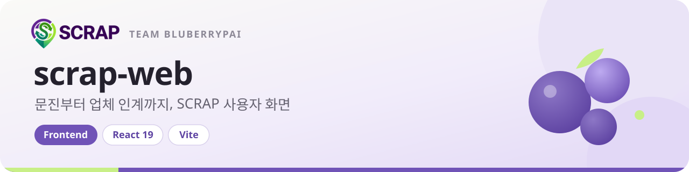

<div align="center">



<br>


[실행](#실행) · [화면](#화면) · [서버-연동](#서버-연동) · [구조](#구조) · [Docker](#docker)

</div>

SCRAP의 **frontend** 레포. 문진부터 업체 검토·기업 간 인계·법정 서식까지의 화면과 지도·3D 시각화를 담당함.

- 하지 않는 일: DB 직접 접근, diagnosis·route 직접 호출 (항상 scrap-server API를 거침)
- 팀 공통 규칙: 조직 `.github` 레포의 [CONTRIBUTING.md](https://github.com/BluberrypAI/.github/blob/main/CONTRIBUTING.md)

## 실행

```bash
npm ci
npm run dev        # http://localhost:5173
```

scrap-server가 8000 포트에서 떠 있어야 로그인·문진·인계가 동작함 (server `backend/README.md`의 "프론트엔드와 함께 실행"). 다섯 서비스를 한꺼번에 띄우려면 scrap-infra의 통합 compose를 사용함 (web은 http://localhost:5178).

> [!IMPORTANT]
> 브라우저는 **`http://localhost:5173`** 으로 엶. 소셜 로그인 콜백이 `localhost:8000`으로 오므로 `127.0.0.1`로 열면 로그인 쿠키가 보이지 않음. OAuth 키가 없으면 로그인 화면의 "개발용 로그인"(dev 모드에서만 보임)을 씀.

```bash
npm test           # node --test (*.test.js)
npm run build      # production build → dist/
```

### 환경변수 (`.env`)

| 변수 | 설명 |
| --- | --- |
| `SCRAP_SERVER_URL` | 개발 서버(Vite)가 `/api/v1`·`/api/treatment`를 넘길 server 주소. 비우면 `http://127.0.0.1:8000` |
| `VITE_KAKAO_MAP_APP_KEY` | 카카오 지도 SDK **JavaScript 키**. 있으면 지도·주소 위치 지정·인계 도로선을 카카오 지도로 표시. REST 키(서버 전용)를 넣지 않음 |
| `VITE_MAPBOX_ACCESS_TOKEN` | 카카오 키가 없을 때 MapLibre 지도의 Mapbox 타일용 공개 토큰(`pk.*`). 없으면 OpenStreetMap 타일 |
| `VITE_ENABLE_DEV_LOGIN` | 빌드에서도 개발용 로그인 버튼 표시 (로컬 통합 실행용, 배포 빌드는 false) |

`VITE_*`는 빌드할 때 코드에 들어가므로 바꾸면 다시 빌드해야 함.

## 화면

라우팅은 해시(`#/경로`) 기반이며 [src/lib/router.js](src/lib/router.js)에 있음. `/app`·`/wastes`·`/lots`·`/map`·`/data`는 로그인하고 기업 등록까지 마친 사용자만 봄.

| 경로 | 화면 | 데이터 |
| --- | --- | --- |
| `/`, `/about` | 랜딩(3D 쇼케이스), 서비스 소개 | 정적 |
| `/login`, `/onboarding` | 소셜·개발용 로그인, 기업 등록(주소 검색·지도 위치) | server |
| `/wastes` | 내 폐기물: 문진 건과 처리 중인 물량 카드 | server |
| `/wastes/case-{id}/survey` | 문진 대화 (말·버튼 답, 판정 보드, 서류 업로드, 질문 답변) | server → diagnosis |
| `/wastes/case-{id}` | 확정 건의 처리 경로: 형태·중량·사진 → 업체 검토(진행 Orb) → 도로거리순 5곳 → 인수 요청 | server → route |
| `/wastes/case-{id}/documents` | 법정 서식 제6·12·5호 미리보기·서명·HWPX/PDF 받기 ([설명](src/features/documents/README.md)) | server |
| `/lots/{id}`, `/lots/{id}/receive/{offer}` | 물량 진행: 문의·조건부 수락·자료 제출·QR 입고·산출물·다음 업체/완료 | server |
| `/data` | 기업 데이터 관리, 변경 이력, 업체 계정의 반입조건 등록, 탈퇴 | server |
| `/map`, `/map/{id}` | 순환자원 처리업체 지도·상세 | 정적 시연 데이터(`src/data/handlers.js`) |
| `/track/{id}` | 이전 시연용 추적 화면 | 정적·브라우저 저장 |

### 사용 흐름

1. 로그인 후 기업을 등록하고 지도에 사업장 위치를 찍음
2. 새 문진을 열어 질문에 답하고 분류번호를 확정함 (문진 엔진은 server가 중계)
3. 확정 건에서 현재 형태·중량·상태 설명·사진을 더해 물량을 등록하고 **업체 검토 시작**을 누름. 서버가 도로거리순 가까운 5곳을 AI로 검토하고, 화면은 서버의 실제 진행 단계를 읽어 표시함
4. 후보 업체(B)에 인수를 요청함. B는 대화에서 반입조건을 확인하고 수락·거절·조건부 수락을 선택함. 조건부면 A가 자료를 내고 B가 모두 확인해야 QR이 발급됨
5. B가 QR로 입고를 확인하고 실제 산출물을 기록함. 이어서 다음 업체(C) 검토, 보관, 또는 완료를 선택함. 기록은 server DB에 저장되어 참여 기업이 함께 봄

> [!NOTE]
> AI 검토는 공정 관련성과 공개 근거를 확인할 뿐 반입을 승인하지 않음. 최종 수락은 수신 업체가 함. 지도에는 도로거리가 확인된 업체만 순위로 표시하고, 직선거리를 도로거리처럼 표시하지 않음. 인계 지도의 점선은 카카오 길찾기의 예정 경로이며 실제 차량 GPS가 아님.

## 서버 연동

회원·기업·문진·인계 API(`/api/v1`)와 처리 경로 API(`/api/treatment`)는 로그인 쿠키(httpOnly) 때문에 **같은 출처**로만 호출함. 개발 중에는 Vite가, 운영에서는 nginx가 `/api` 요청을 server로 넘김.

| 파일 | 역할 |
| --- | --- |
| [src/lib/api.js](src/lib/api.js) | API 호출. 401이면 토큰을 한 번 재발급하고 다시 보냄. 오류는 서버 형식(`code`, `message`, `details`)의 `ApiError`로 던짐 |
| [src/lib/session.js](src/lib/session.js) | 로그인 상태 판단 (`signed-out`, `onboarding`, `ready`)과 이동할 화면 결정 |
| [src/hooks/useSession.js](src/hooks/useSession.js) | 화면에서 로그인 상태를 쓰는 훅. `useRequireSession`은 상태에 맞지 않으면 로그인·온보딩·앱 화면으로 보냄 |
| [src/lib/auth.js](src/lib/auth.js) | 서버 응답 전에 그려야 하는 곳에서 쓰는 로그인 힌트(localStorage). 기준은 항상 `/users/me` |
| [src/features/diagnosis/lib/client.js](src/features/diagnosis/lib/client.js) | 문진 API (`/api/v1/diagnosis/*`) |
| [src/features/workflow/api.js](src/features/workflow/api.js) | 처리 경로·업체 검토·인계 API (`/api/v1/workflow/*`, `/api/v1/diagnosis/cases/{id}/treatment/*`). 공정별 공개 웹 조사는 [ProcessDiscovery.jsx](src/features/workflow/ProcessDiscovery.jsx)가 `/api/treatment/*`로 호출 |

서버는 로그인 뒤 `/onboarding`, `/login?error=...` 같은 일반 경로로 보내고, [src/lib/router.js](src/lib/router.js)가 이를 해시 주소(`/#/onboarding`)로 바꿈.

처리 경로 결과가 비면 서버 응답을 그대로 구분해 안내함: 공정 자료 미지원, 공정은 있지만 업체 없음, 조회 실패, 마지막 산출 상태. 후보가 없다고 재활용 불가·처리 완료로 판단하지 않음. 문진 번호를 다른 번호로 바꿔 우회하지 않으며, 지원 범위는 연결된 server 버전과 공정 참조 데이터를 따름.

## 구조

```
index.html              # <div id="root"> + src/main.jsx
public/                 # 그대로 서빙되는 정적 파일 (이미지, 파비콘, 법정 서식 그림·칸 위치)
src/
├─ main.jsx · App.jsx   # 진입점, 최상위 경로 분기 (/, /about, /login, /onboarding, /track, 앱 화면)
├─ layouts/AppShell.jsx # 상단 내비게이션이 있는 앱 화면과 작업 화면 분기
├─ features/
│  ├─ diagnosis/        # 문진 대화·이력, 판정 보드, 서류 업로드
│  ├─ workflow/         # 처리 경로·업체 검토(Orb)·후보 지도·인수 요청·조건·QR·산출물·반입조건
│  ├─ documents/        # 법정 서식 작성 (미리보기, 서명·도장)
│  ├─ treatment/        # 처리 경로 상태·증빙 로직, 3D 모식도
│  └─ tracking/         # 시연용 추적 화면의 현장 확인 기록 (브라우저 저장)
├─ pages/               # 화면 단위 (landing, about, auth, wastes, waste-detail, data, map, survey, match, report)
├─ components/          # 공용 컴포넌트 (상단 내비, 알림함, 사업장 위치 선택, 투어 …)
├─ hooks/ · lib/        # 로그인 상태 훅, 라우팅·API·세션·지도 스타일
├─ data/                # 시연용 정적 데이터 (처리업체, 폐기물 예시, 메뉴)
└─ styles/global.css    # 전역 스타일·색 토큰 (SCRAP 보라 #7053b7, 라임 #c8ef87)
```

화면 문구나 레이아웃은 해당 화면 파일을 고치면 됨. 색은 `global.css`의 `--color-*` 토큰을 사용함 (라이트·다크 모두 정의).

## Docker

빌드한 정적 파일을 nginx로 서빙하고 `/api/` 요청을 `SCRAP_SERVER_URL`(기본 `http://host.docker.internal:8000`)로 전달함.

```bash
docker build -t scrap-web --build-arg VITE_KAKAO_MAP_APP_KEY=<JavaScript 키> .
docker run --rm -p 8080:80 -e SCRAP_SERVER_URL=http://host.docker.internal:8000 scrap-web
```

http://localhost:8080 에서 확인함. 서버를 같은 Docker 네트워크에서 실행한다면 `SCRAP_SERVER_URL`을 서버 컨테이너 주소(예: `http://server:8000`)로 바꿈.

- 프록시 응답 대기는 600초 (여러 업체 AI 검토가 기본 60초에 잘리지 않게). 실제 모델 호출은 server·route의 개별 제한을 따름
- 서버 컨테이너가 다시 만들어져 IP가 바뀌어도 실행 환경의 DNS로 다시 찾음 ([nginx/](nginx/))
- `/assets/`는 1년, `/images/`는 하루 캐시

## 브랜치·배포

작업 브랜치 → `develop` (PR, CI 통과 후 작성자가 병합) → `main` (배포, 서버 담당자)

| 워크플로 | 하는 일 |
| --- | --- |
| [ci.yml](.github/workflows/ci.yml) | Node 22에서 `npm ci` → build → test |
| [deploy-azure.yml](.github/workflows/deploy-azure.yml) | main 병합 시 이미지를 ACR `:main`으로 push → ACR 웹훅으로 App Service 재시작 (Front Door 뒤) |

날짜별 검증 기록은 [docs/](docs/)에 있음.
